# Sistema de Permisos - Diagramas de Flujo

## Tabla de Contenidos

1. [Jerarquía de Niveles](#1-jerarquía-de-niveles)
2. [Flujo de Creación de Usuarios](#2-flujo-de-creación-de-usuarios)
3. [Flujo de Gestión de Usuarios](#3-flujo-de-gestión-de-usuarios)
4. [Flujo de Visibilidad de Datos](#4-flujo-de-visibilidad-de-datos)
5. [Flujo de Permisos de Contactos](#5-flujo-de-permisos-de-contactos)
6. [Flujo de Gestión de Equipos](#6-flujo-de-gestión-de-equipos)
7. [Matriz de Referencia Rápida](#7-matriz-de-referencia-rápida)

---

## 1. Jerarquía de Niveles

### 1.1 Estructura de Niveles

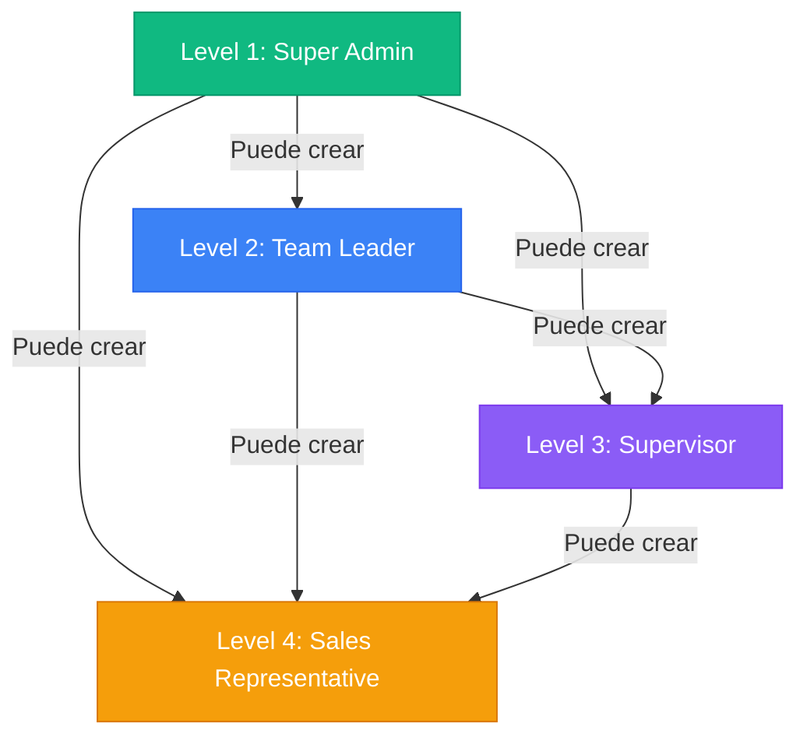

### 1.2 Relaciones de Reporte Permitidas

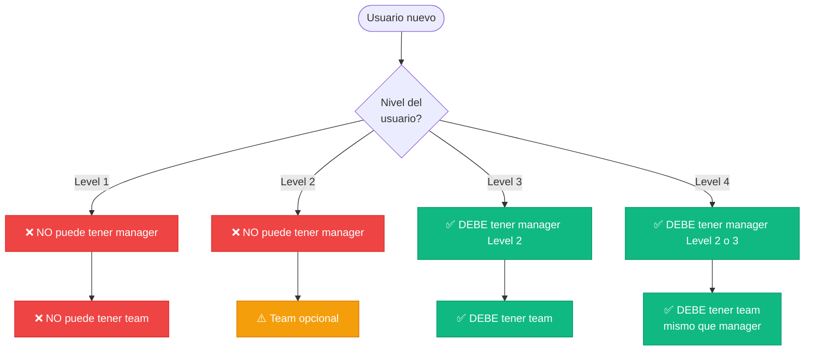

---

## 2. Flujo de Creación de Usuarios

### 2.1 ¿Puede crear usuario de nivel X?

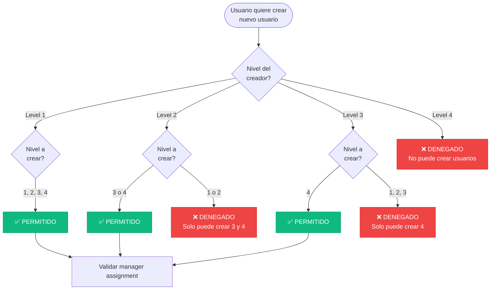

### 2.2 Validación de Manager Assignment

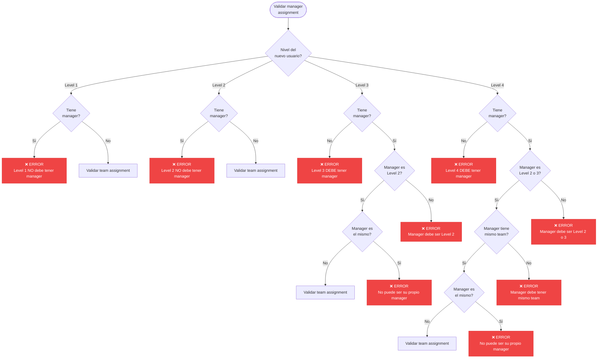

### 2.3 Validación de Team Assignment

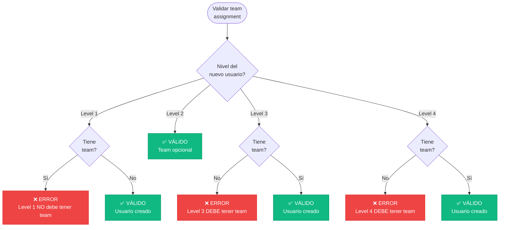

---

## 3. Flujo de Gestión de Usuarios

### 3.1 ¿Puede editar usuario?

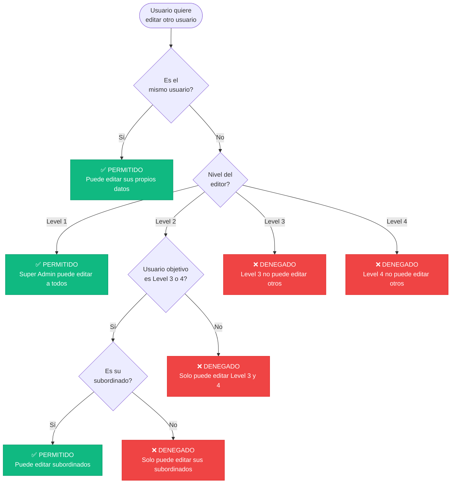

### 3.2 ¿Puede eliminar usuario?

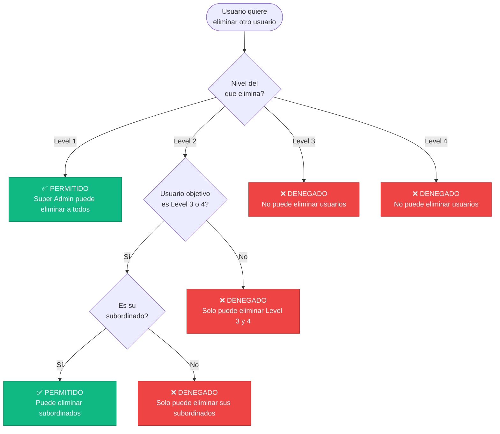

### 3.3 Función canManageUser()

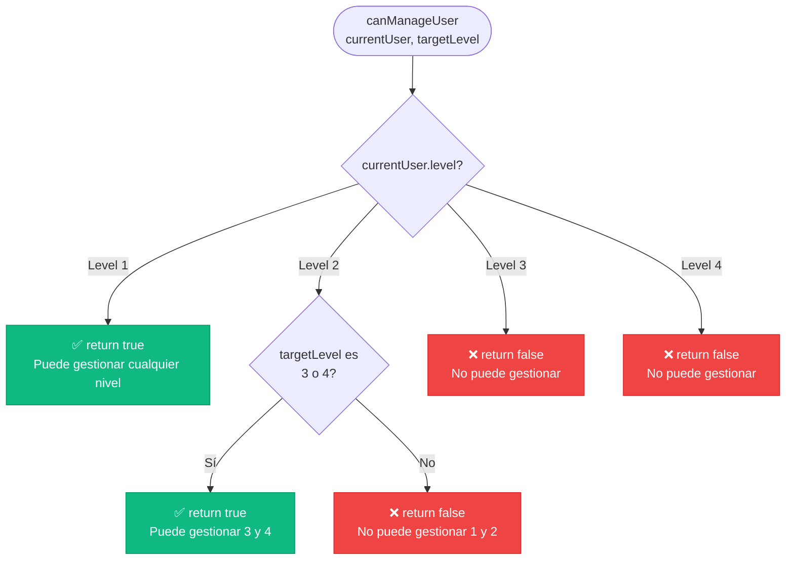

---

## 4. Flujo de Visibilidad de Datos

### 4.1 Visibilidad de Usuarios

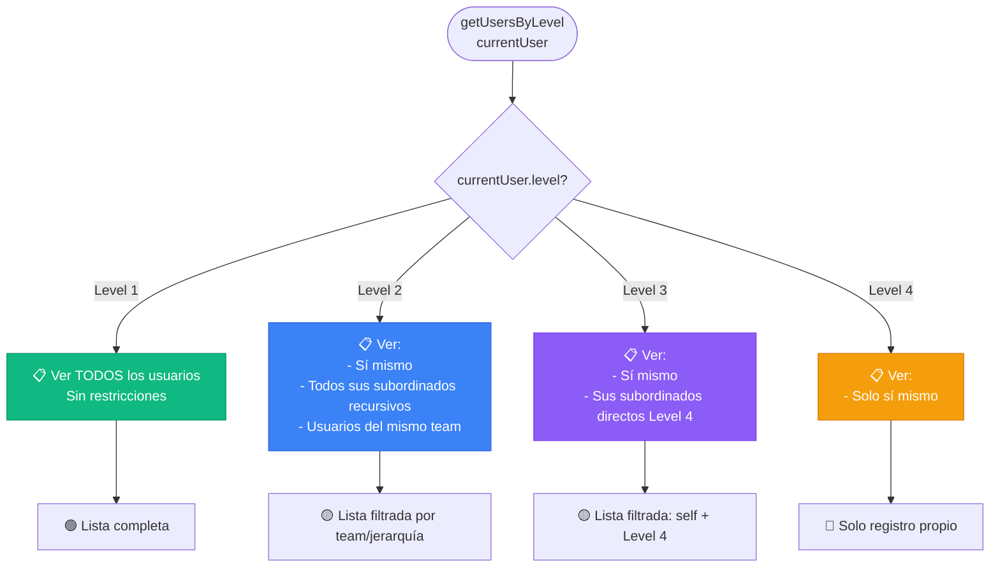

### 4.2 Visibilidad de Deals

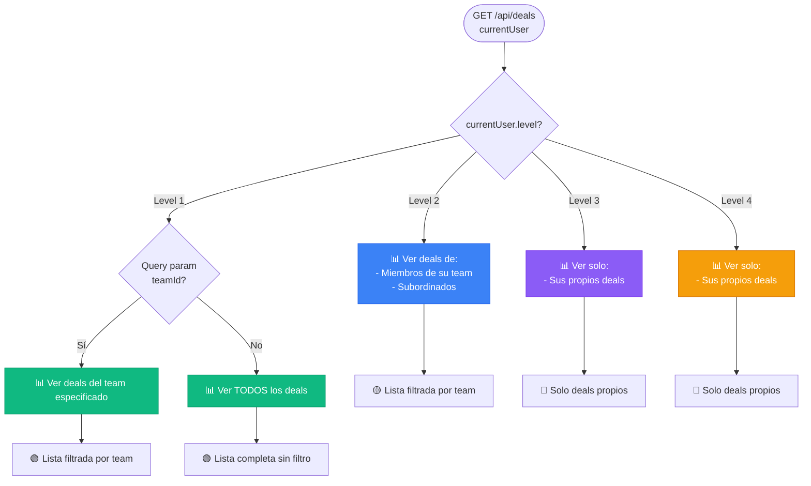

### 4.3 Visibilidad de Contactos - Datos Sensibles

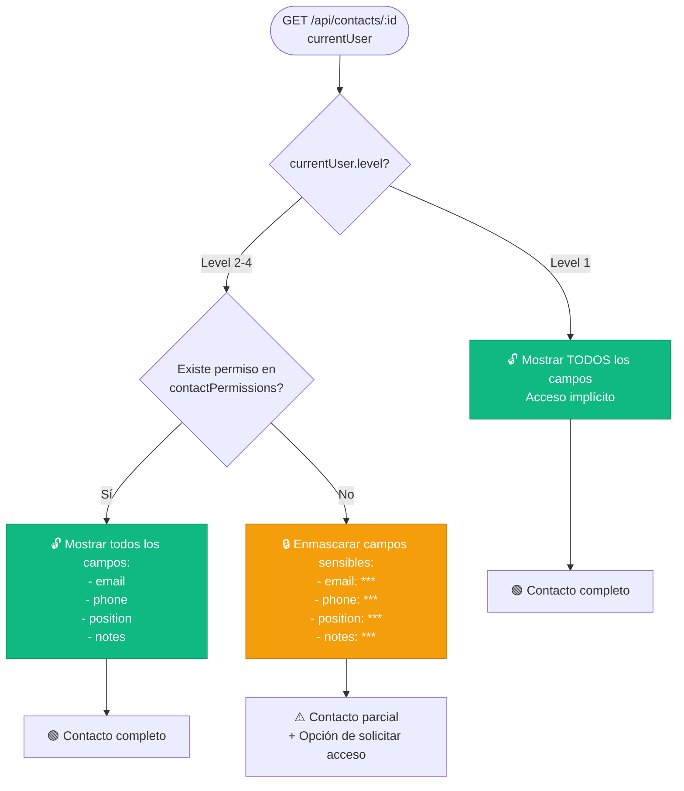

---

## 5. Flujo de Permisos de Contactos

### 5.1 Ciclo Completo de Solicitud de Acceso

```mermaid
flowchart TD
    Start([Usuario Level 2-4<br/>intenta ver contacto])
    CheckPerm{Tiene permiso<br/>en DB?}

    Start --> CheckPerm

    CheckPerm -->|Sí| ShowFull[🟢 Mostrar contacto completo]
    CheckPerm -->|No| ShowMasked[⚠️ Mostrar contacto enmascarado]

    ShowMasked --> UserAction{Usuario<br/>hace click en<br/>"Solicitar acceso"}

    UserAction -->|Sí| CreateRequest[📝 POST /api/contact-access-requests<br/>Crear solicitud]
    UserAction -->|No| End1[Fin - Sin acceso]

    CreateRequest --> SaveRequest[(Guardar en DB:<br/>contactAccessRequests<br/>status: pending)]

    SaveRequest --> Notification[🔔 Notificar a Super Admins<br/>Level 1]

    Notification --> AdminReview[👤 Super Admin revisa solicitud<br/>en página /solicitudes]

    AdminReview --> AdminDecision{Decisión del<br/>Admin?}

    AdminDecision -->|Aprobar| Approve[✅ PATCH request<br/>status: approved]
    AdminDecision -->|Rechazar| Reject[❌ PATCH request<br/>status: rejected]

    Approve --> CreatePermission[(Crear registro en:<br/>contactPermissions<br/>userId + contactId)]

    CreatePermission --> NotifyApproved[🔔 Notificar al usuario<br/>Acceso concedido]

    Reject --> NotifyRejected[🔔 Notificar al usuario<br/>Acceso denegado]

    NotifyApproved --> UserRefresh[Usuario recarga contacto]

    UserRefresh --> ShowFull2[🟢 Mostrar contacto completo<br/>email, phone, position, notes]

    NotifyRejected --> End2[Fin - Sin acceso]

    style ShowFull fill:#10b981,stroke:#059669,color:#fff
    style ShowFull2 fill:#10b981,stroke:#059669,color:#fff
    style ShowMasked fill:#f59e0b,stroke:#d97706,color:#fff
    style CreatePermission fill:#10b981,stroke:#059669,color:#fff
    style Approve fill:#10b981,stroke:#059669,color:#fff
    style Reject fill:#ef4444,stroke:#dc2626,color:#fff
```

### 5.2 Verificación de Permisos en API

```mermaid
flowchart TD
    Start([API recibe request<br/>GET /api/contacts/:id])
    GetUser[Obtener currentUser<br/>de sesión]

    Start --> GetUser

    GetUser --> CheckLevel{currentUser.level?}

    CheckLevel -->|Level 1| QueryContact[📊 Query contact<br/>de base de datos]
    CheckLevel -->|Level 2-4| QueryPermission{Buscar en<br/>contactPermissions<br/>userId + contactId?}

    QueryPermission -->|Encontrado| QueryContact
    QueryPermission -->|No encontrado| QueryContact

    QueryContact --> ApplyMask{currentUser.level === 1<br/>OR<br/>existe permiso?}

    ApplyMask -->|Sí| ReturnFull[return {<br/>  email: actual<br/>  phone: actual<br/>  position: actual<br/>  notes: actual<br/>}]

    ApplyMask -->|No| ReturnMasked[return {<br/>  email: '***'<br/>  phone: '***'<br/>  position: '***'<br/>  notes: '***'<br/>}]

    style ReturnFull fill:#10b981,stroke:#059669,color:#fff
    style ReturnMasked fill:#f59e0b,stroke:#d97706,color:#fff
```

---

## 6. Flujo de Gestión de Equipos

### 6.1 ¿Puede crear teams?

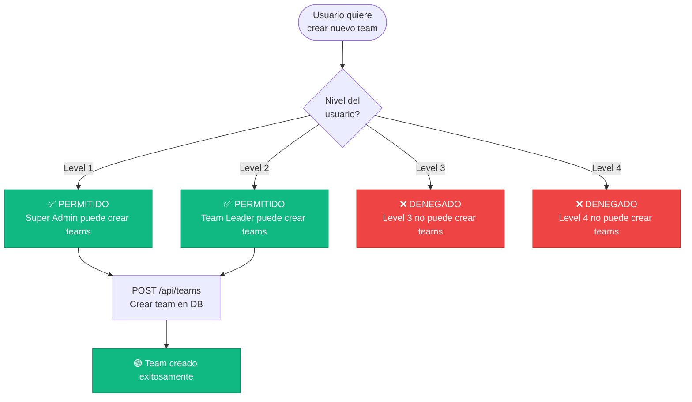

### 6.2 Asignación de Equipos a Usuarios

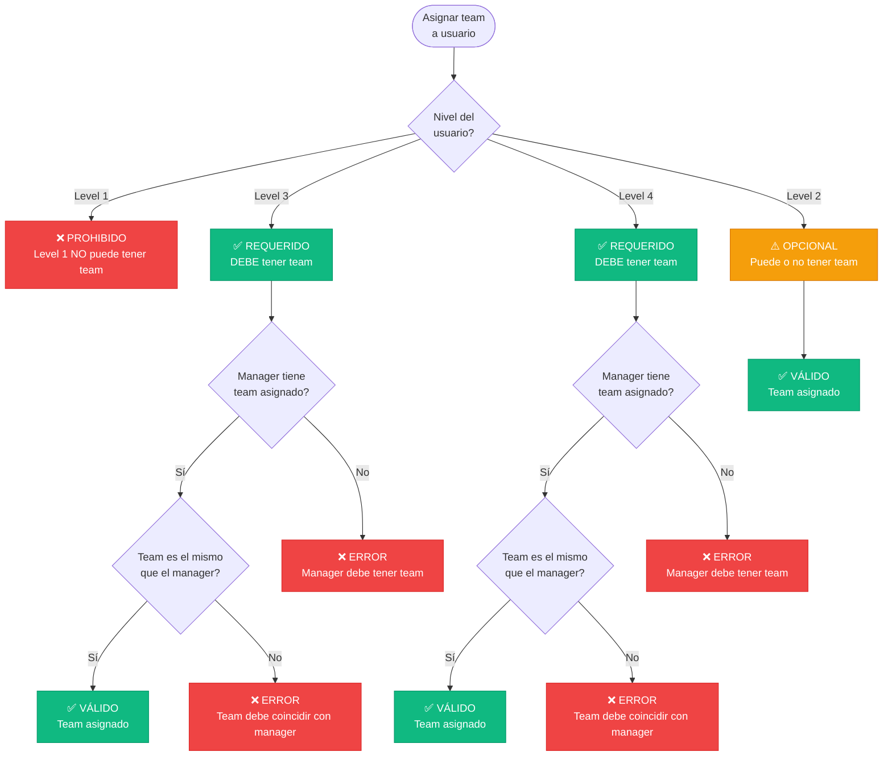

---

## 7. Matriz de Referencia Rápida

### 7.1 Capacidades por Nivel

| Capacidad | Level 1<br/>Super Admin | Level 2<br/>Team Leader | Level 3<br/>Supervisor | Level 4<br/>Sales Rep |
|-----------|------------------------|------------------------|----------------------|---------------------|
| **Creación de Usuarios** |
| Crear Level 1 | ✅ Sí | ❌ No | ❌ No | ❌ No |
| Crear Level 2 | ✅ Sí | ❌ No | ❌ No | ❌ No |
| Crear Level 3 | ✅ Sí | ✅ Sí | ❌ No | ❌ No |
| Crear Level 4 | ✅ Sí | ✅ Sí | ✅ Sí | ❌ No |
| **Gestión de Usuarios** |
| Editar cualquier usuario | ✅ Sí | ❌ No | ❌ No | ❌ No |
| Editar subordinados | ✅ Sí | ✅ Sí (L3/L4) | ❌ No | ❌ No |
| Editar propios datos | ✅ Sí | ✅ Sí | ✅ Sí | ✅ Sí |
| Eliminar usuarios | ✅ Sí | ✅ Sí (L3/L4) | ❌ No | ❌ No |
| **Visibilidad de Usuarios** |
| Ver todos los usuarios | ✅ Sí | ❌ No | ❌ No | ❌ No |
| Ver team + subordinados | ✅ Sí | ✅ Sí | ❌ No | ❌ No |
| Ver subordinados directos | ✅ Sí | ✅ Sí | ✅ Sí (L4) | ❌ No |
| Ver solo a sí mismo | ✅ Sí | ✅ Sí | ✅ Sí | ✅ Sí |
| **Visibilidad de Deals** |
| Ver todos los deals | ✅ Sí | ❌ No | ❌ No | ❌ No |
| Ver deals por team | ✅ Sí (filtrable) | ✅ Sí (su team) | ❌ No | ❌ No |
| Ver solo propios deals | ✅ Sí | ✅ Sí | ✅ Sí | ✅ Sí |
| **Permisos de Contactos** |
| Acceso implícito a todos | ✅ Sí | ❌ No | ❌ No | ❌ No |
| Requiere permiso explícito | ❌ No | ✅ Sí | ✅ Sí | ✅ Sí |
| Solicitar acceso a contacto | ❌ N/A | ✅ Sí | ✅ Sí | ✅ Sí |
| Aprobar solicitudes acceso | ✅ Sí | ❌ No | ❌ No | ❌ No |
| Ver contactos enmascarados | ❌ No | ✅ Sí | ✅ Sí | ✅ Sí |
| **Gestión de Equipos** |
| Crear teams | ✅ Sí | ✅ Sí | ❌ No | ❌ No |
| Editar teams | ✅ Sí | ✅ Sí | ❌ No | ❌ No |
| Ver todos los teams | ✅ Sí | ✅ Sí | ⚠️ Limitado | ⚠️ Limitado |
| **Restricciones de Estructura** |
| Debe tener manager | ❌ No | ❌ No | ✅ Sí (L2) | ✅ Sí (L2/L3) |
| Debe tener team | ❌ No | ⚠️ Opcional | ✅ Sí | ✅ Sí |
| Puede tener subordinados | ✅ Sí | ✅ Sí | ✅ Sí (L4) | ❌ No |
| **Funcionalidades Especiales** |
| Acceso a /solicitudes | ✅ Sí | ❌ No | ❌ No | ❌ No |
| Gestión de branding | ✅ Sí | ❌ No | ❌ No | ❌ No |
| Gestión de currency | ✅ Sí | ❌ No | ❌ No | ❌ No |
| Impersonation | ✅ Sí | ❌ No | ❌ No | ❌ No |

### 7.2 Función de Referencia Rápida: getAvailableLevels()

| Nivel del Usuario | Niveles que Puede Crear | Retorno de Función |
|------------------|------------------------|-------------------|
| Level 1 | 2, 3, 4 | `[2, 3, 4]` |
| Level 2 | 3, 4 | `[3, 4]` |
| Level 3 | 4 | `[4]` |
| Level 4 | Ninguno | `[]` |

### 7.3 Campos Enmascarados en Contactos

| Campo | Sin Permiso | Con Permiso |
|-------|------------|-------------|
| email | `***` | `usuario@example.com` |
| phone | `***` | `+1234567890` |
| position | `***` | `CEO` |
| notes | `***` | `Notas completas...` |
| name | ✅ Visible | ✅ Visible |
| company | ✅ Visible | ✅ Visible |
| createdAt | ✅ Visible | ✅ Visible |
| updatedAt | ✅ Visible | ✅ Visible |

---

## Referencias de Código

### Archivos Principales

- **Schema de DB**: `src/lib/db/schema.ts`
- **Utilidades de Permisos**: `src/lib/utils.ts`
  - `canManageUser()`
  - `getAvailableLevels()`
- **Servicio de Usuarios**: `src/lib/services/user.service.ts`
  - `getUsersByLevel()`
  - Validaciones de manager/team
- **Servicio de Permisos de Contactos**: `src/lib/services/contact-permission.service.ts`
  - `maskContactFields()`
  - `checkContactPermission()`
- **API de Usuarios**: `src/app/api/users/route.ts`
- **API de Deals**: `src/app/api/deals/route.ts`
- **API de Teams**: `src/app/api/teams/route.ts`
- **API de Contact Access Requests**: `src/app/api/contact-access-requests/route.ts`

### Schemas de Validación

- **User Schema**: `src/lib/schemas/user.ts`
- **Auth Config**: `src/lib/auth.ts`

---

**Última actualización**: 2026-01-23
